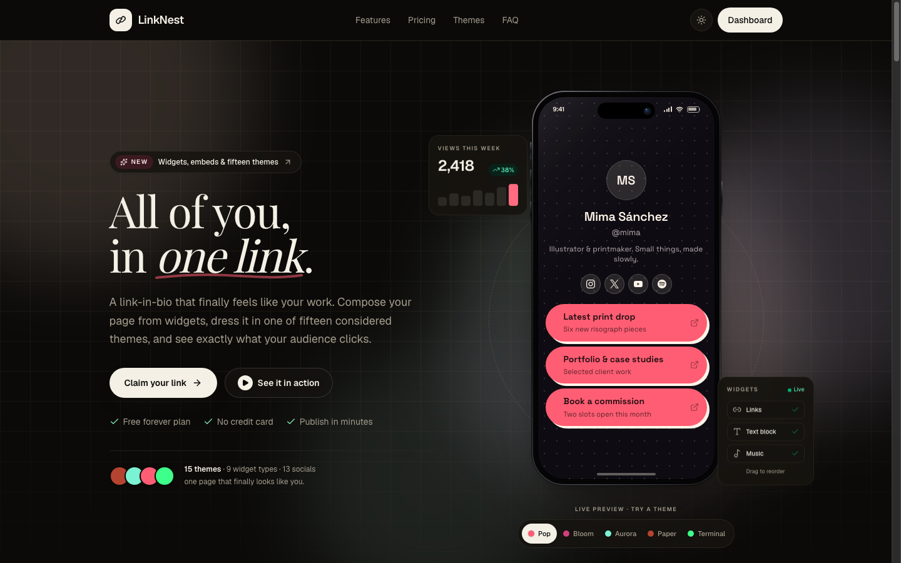
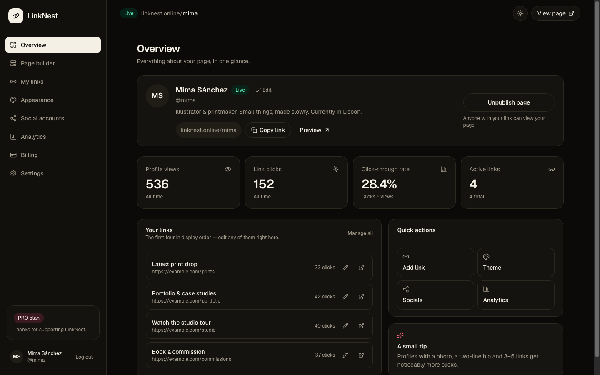
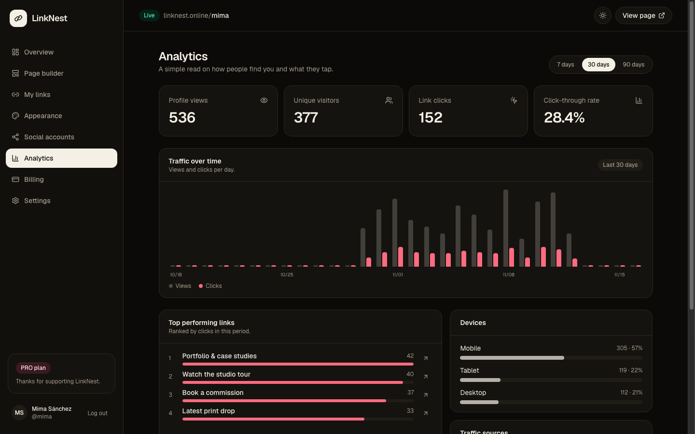
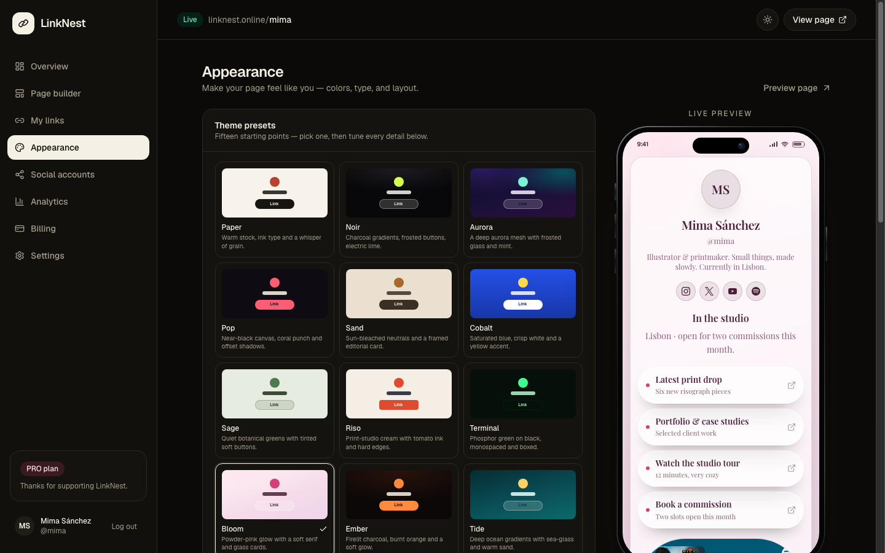
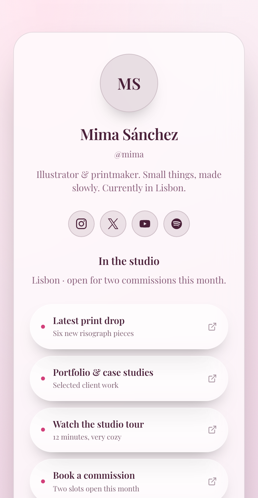

# LinkNest

A link-in-bio SaaS: one customizable public page for every link you share.

**Live demo:** https://linknest.online — log in with `demo@linknest.com` /
`password123` (Pro plan, all features unlocked) and view the seeded profile at
[/mima](https://linknest.online/mima).

Built from the product requirements in [`PRD.md`](./PRD.md). This repository currently covers
Phases 1–5 of the MVP roadmap: authentication and onboarding, link and social management,
public profiles with themes, first-party analytics, and Lemon Squeezy subscriptions.

## Screenshots



| Dashboard | Analytics |
| :---: | :---: |
|  |  |

| Theme editor | Public profile |
| :---: | :---: |
|  |  |

## Stack

| Layer | Choice |
| --- | --- |
| Framework | Next.js 16 (App Router, Server Actions) |
| Language | TypeScript |
| Styling | Tailwind CSS 4 |
| Database | PostgreSQL |
| ORM | Prisma 6 |
| Auth | Auth.js (NextAuth v5), credentials + JWT sessions |
| Icons | lucide-react, react-icons |
| Validation | Zod |

UI primitives are hand-rolled with Tailwind instead of shadcn/ui to keep the dependency surface
small. They live in `src/components/ui/` and follow the same composition pattern.

## Getting started

Requirements: Node 22+, pnpm, PostgreSQL 14+.

```bash
pnpm install

# 1. Create a database
createdb linknest

# 2. Configure environment
cp .env.example .env
# edit DATABASE_URL, set AUTH_SECRET (openssl rand -base64 32)

# 3. Push the schema and seed the demo account
pnpm db:push
pnpm db:seed

# 4. Run
pnpm dev
```

Demo login: `demo@linknest.com` / `password123` → public page at `/mima`.

## Scripts

| Script | Purpose |
| --- | --- |
| `pnpm dev` | Development server |
| `pnpm build` / `pnpm start` | Production build and server |
| `pnpm typecheck` | TypeScript, no emit |
| `pnpm lint` | ESLint |
| `pnpm db:push` | Sync schema to the database |
| `pnpm db:migrate` | Create a migration |
| `pnpm db:seed` | Seed the demo account |
| `pnpm db:studio` | Prisma Studio |

## Routes

**Marketing:** `/`, `/features`, `/pricing`, `/faq`, `/about`, `/contact`, `/privacy`, `/terms`

**Auth:** `/signup`, `/login`, `/forgot-password`, `/reset-password`, `/verify-email`

**App:** `/onboarding`, `/dashboard`, `/dashboard/widgets`, `/dashboard/links`,
`/dashboard/appearance`, `/dashboard/socials`, `/dashboard/analytics`, `/dashboard/billing`,
`/dashboard/settings`

**Public:** `/:username`, tracked link redirects at `/l/:linkId`, tracking endpoint
`POST /api/track`

**Webhooks:** `POST /api/webhooks/lemonsqueezy` for subscription lifecycle events (HMAC-SHA256
signature verified against `LEMONSQUEEZY_WEBHOOK_SECRET`)

## What works

- Email/password signup, login, logout, persistent sessions, email verification and email-based
  password reset through Resend
- Onboarding with username claim, profile details, first link and social account
- Profile editing, username changes, email and password changes, account deletion, and inline
  display-name/photo editing from the dashboard overview
- Profile photo uploads stored in Vercel Blob (JPG, PNG, WebP, GIF, AVIF up to 5 MB)
- Link CRUD, show/hide, drag-and-drop and keyboard reordering, per-link clicks
- 13 social platforms with icons, reordering, show/hide
- Widget-based page builder: header, links, socials, text, image, video, music, CTA and divider
  blocks, reorderable by drag-and-drop or arrows, each with visibility and inline editing
- Fifteen theme presets (Paper, Noir, Aurora, Pop, Sand, Cobalt, Sage, Riso, Terminal, Bloom,
  Ember, Tide, Mono, Citrus, Dusk) with full control over colors, button style/shape, shadow,
  texture, avatar shape, font and layout
- Allowlisted embeds for YouTube, Vimeo and Spotify; raw iframe URLs are never rendered
- Live previews in onboarding, the appearance editor and the page builder
- Publish/unpublish with owner-only preview of unpublished pages
- Public pages with SEO/Open Graph metadata, responsive layout, branding on the free plan
- First-party analytics: views, estimated uniques, clicks, CTR, top links, devices, referrers,
  7/30/90-day ranges
- Lemon Squeezy subscriptions: hosted checkout, signed webhooks that sync plan/status/period end,
  a customer portal link, and in-app plan cancellation with end-of-period access
- Password changes and resets revoke older sessions; account deletion cancels the Lemon Squeezy
  subscription and removes the uploaded avatar
- Plan-aware gating: Free gets Paper, Noir, Cobalt, Ember, Bloom, Sage and Riso, 10 links,
  6 widgets, 7-day analytics, no link thumbnails or custom background images; Pro unlocks all
  15 themes, the mono font, thumbnails, backgrounds, 200 links, 24 widgets and 30/90-day
  device/source analytics
- Theme presets apply instantly; Free users can preview Pro themes but need an upgrade to save them
- Light and dark site themes with a persisted header toggle and system-preference default
- Input validation, ownership checks on every mutation, rate limits on auth and tracking

## Known gaps / next milestones

- **Billing lifecycle**: subscription and cancellation emails rely on Lemon Squeezy's own customer
  emails; there is no in-app invoice history yet.
- **Proration**: switching between Pro and Business happens in the Lemon Squeezy customer portal so
  the provider calculates proration.
- **Email delivery**: transactional email uses Resend. Set `RESEND_API_KEY` and verify the
  `linknest.online` sending domain in Resend. Without a key, development logs the email instead
  and production cannot deliver verification or reset messages.
- **Security headers**: `X-Frame-Options`, `nosniff`, Referrer-Policy and Permissions-Policy are
  enforced; CSP is report-only until Next's inline bootstrap scripts are audited.
- **Images**: profile photos upload to Vercel Blob. Link icons and theme background images are
  still URL fields; move them to the same upload pipeline next.
- **Analytics scale**: events are written inline. Move ingestion to a queue and aggregate for
  high traffic; the schema is already indexed for the common queries.
- **Rate limiting** is in-memory and per-instance. Swap for Redis/Upstash when running more than
  one instance.
- **Custom domains, multiple profiles, team features**: out of MVP scope per the PRD.
- **Promised but not built yet**: scheduled links, custom domains, multiple profiles, lead capture,
  email integrations and team collaboration. They are labelled “coming soon” on the plans.
- **Automated tests**: none yet. Add Playwright for the core flows and Vitest for validation
  helpers.

## Project layout

```
prisma/
  schema.prisma        # User, Profile, Link, SocialAccount, Widget, AnalyticsEvent, Subscription
  seed.ts              # Demo account with widgets, theme and 14 days of analytics
src/
  app/
    (marketing)/       # Public marketing site
    (auth)/            # Login, signup, password reset + server actions
    dashboard/         # Authenticated app + per-section server actions
    [username]/        # Public profile page
    l/[linkId]/        # Click tracking redirect
    api/               # Auth.js handlers and view tracking
  components/          # UI primitives, profile canvas, dashboard managers
  lib/                 # Auth, Prisma, analytics, themes, widgets, embeds, validation
```

## Design decisions

- **Server Actions over API routes** for mutations: less client code, progressive enhancement,
  and authorization stays next to the data change.
- **JWT sessions** avoid a session table and keep the credentials flow simple. Swap to database
  sessions when adding OAuth providers.
- **Theme as validated JSON** on the profile rather than a separate table: themes are edited as a
  unit and read on every public page.
- **Widgets as ordered rows**: each widget stores its own validated JSON config, so the page
  builder can add, reorder and restyle sections without schema changes. The public page and both
  previews share one `ProfileCanvas` renderer, so what you see in the dashboard is what ships.
- **Generated, allowlisted embeds**: video and music widgets resolve YouTube, Vimeo and Spotify
  URLs into known embed origins instead of accepting arbitrary iframe markup.
- **Denormalized `Link.clicks`** alongside `AnalyticsEvent` so dashboards and link lists stay fast
  without scanning events.
- **Cookie-free analytics** with a daily rotating visitor hash, matching the privacy copy.
- **Cache Components disabled** in `next.config.ts`: the app is auth- and session-driven, so
  request-time rendering is the correct default here.

## Deployment notes

- Set `DATABASE_URL`, `AUTH_SECRET`, `NEXT_PUBLIC_APP_URL` in the host environment.
- Set `RESEND_API_KEY` and `EMAIL_FROM` (for example `LinkNest <hello@linknest.online>`) for
  verification and password-reset email. Verify the sending domain in Resend first.
- Connect a Vercel Blob store so `BLOB_READ_WRITE_TOKEN` is available for profile photo uploads.
- Set `LEMONSQUEEZY_API_KEY`, `LEMONSQUEEZY_STORE_ID`, `LEMONSQUEEZY_VARIANT_PRO`,
  `LEMONSQUEEZY_VARIANT_BUSINESS` and `LEMONSQUEEZY_WEBHOOK_SECRET` to enable billing.
- Add a Lemon Squeezy webhook for `subscription_created`, `subscription_updated`,
  `subscription_cancelled`, `subscription_resumed`, `subscription_expired`,
  `subscription_paused` and `subscription_unpaused`, pointing at
  `https://your-domain/api/webhooks/lemonsqueezy`.
- Run `prisma migrate deploy` on release, then `pnpm build`.
- Public profiles can be cached at the CDN later; analytics writes are already decoupled through
  the tracking endpoint.

### Vercel

The project is deployed at https://linknest.online with a Neon Postgres database
provisioned through the Vercel Marketplace. Pushes to `main` deploy automatically.

```bash
vercel link
vercel integration add neon --name linknest-db

# Apply the schema and seed the hosted database once
set -a && . ./.env.local && set +a
DATABASE_URL="$DATABASE_URL_UNPOOLED" pnpm exec prisma db push
DATABASE_URL="$DATABASE_URL_UNPOOLED" pnpm db:seed

vercel --prod
```

Required production env vars: `DATABASE_URL` (from Neon), `AUTH_SECRET`, and
`NEXT_PUBLIC_APP_URL`. `postinstall` runs `prisma generate` during the Vercel build. For schema
changes, create a Prisma migration and run `prisma migrate deploy` against the unpooled URL.

### Domain

The primary domain is `linknest.online`; `www.linknest.online` redirects to it with a 308. The
domain is attached to the Vercel project. At Namecheap, either:

- Set the nameservers to `ns1.vercel-dns.com` and `ns2.vercel-dns.com` (recommended), or
- Keep Namecheap DNS and add `A @ 216.198.79.1`, `A @ 64.29.17.1`, and
  `CNAME www cname.vercel-dns.com`.
